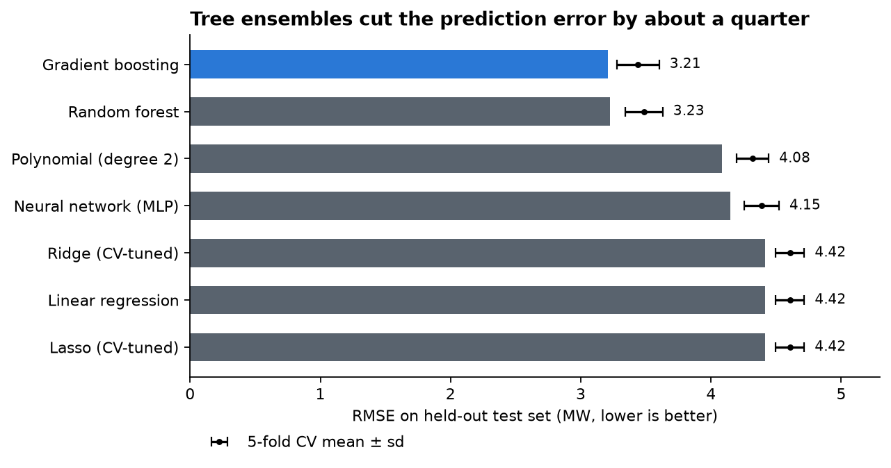
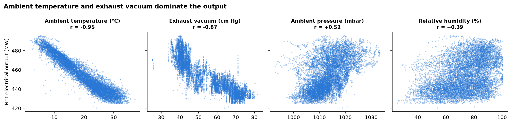
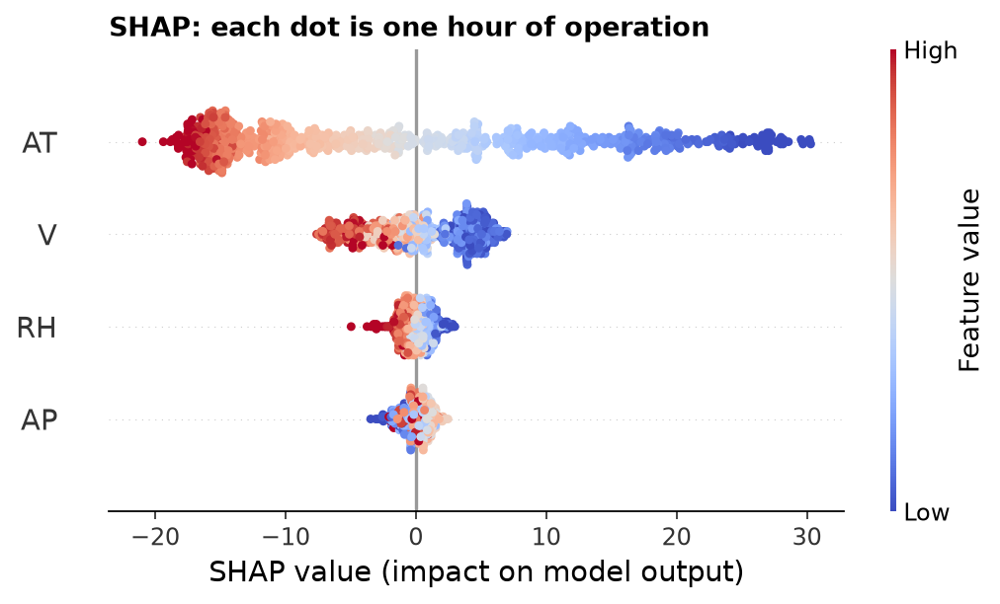
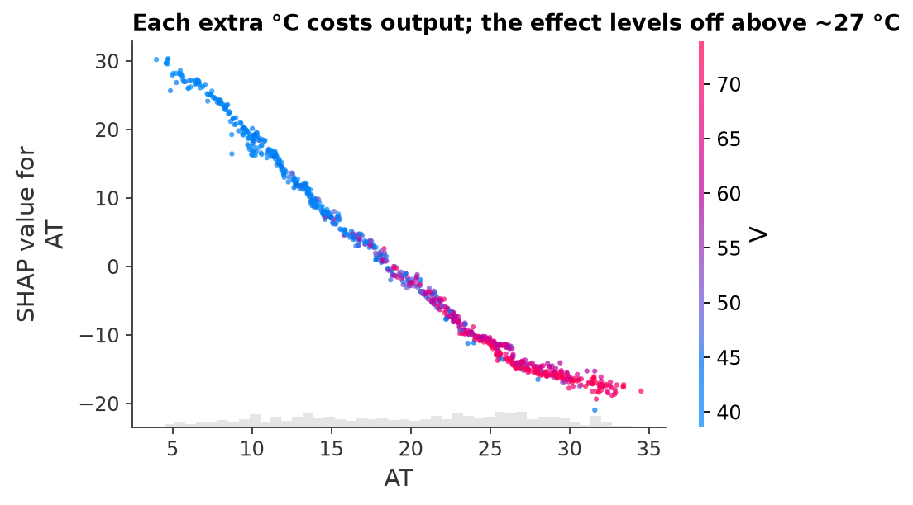
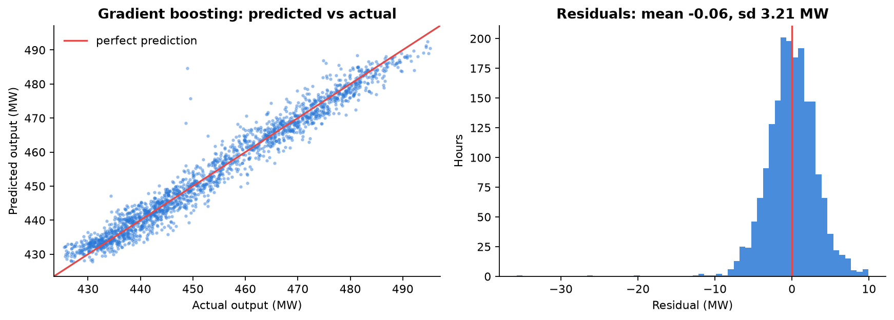

# Predicting Power Plant Output from Ambient Conditions

    

How much electricity will a combined cycle power plant deliver in the next hour, given the weather? This project builds and compares seven regression models that predict a plant's **net electrical output (MW) from four ambient measurements**. It then uses **SHAP** to explain the best model in physical terms.

<p align="center">
  
</p>

## Key results

| Model | Test RMSE (MW) | Test MAE (MW) | Test R² | 5-fold CV RMSE (MW) |
|---|---:|---:|---:|---:|
| **Gradient boosting** | **3.21** | 2.39 | **0.965** | 3.44 ± 0.16 |
| Random forest | 3.23 | **2.33** | 0.964 | 3.49 ± 0.14 |
| Polynomial regression (degree 2) | 4.08 | 3.24 | 0.943 | 4.32 ± 0.12 |
| Neural network (MLP 64-32) | 4.15 | 3.24 | 0.941 | 4.39 ± 0.13 |
| Ridge regression (CV-tuned) | 4.42 | 3.56 | 0.933 | 4.61 ± 0.11 |
| Linear regression (OLS) | 4.42 | 3.56 | 0.933 | 4.61 ± 0.11 |
| Lasso regression (CV-tuned) | 4.42 | 3.56 | 0.933 | 4.61 ± 0.11 |

<sub>Held-out test set: 1,885 hours, 20% of the cleaned data. The output ranges from 420 to 496 MW.</sub>

- 🎯 **Gradient boosting predicts 91% of hours within ±5 MW.** Its error is about 27% lower than that of linear regression.
- 🌡️ **Ambient temperature drives about 71% of the prediction** (share of mean |SHAP|). In the OLS model, each extra °C costs about **2.0 MW** of output.
- 📉 **The temperature effect is not linear.** It is steep up to about 27 °C and levels off above that. This is why tree ensembles outperform linear models.
- ⚖️ **Regularisation does not help here.** Ridge and lasso match plain OLS, because four well-measured predictors give no room for overfitting.

## What drives the output

<p align="center">
  
</p>

Warmer, less dense intake air reduces gas turbine output, so temperature alone has a correlation of r = −0.95 with output. Exhaust vacuum is the second strongest signal, but it is itself correlated with temperature (r = +0.84). That multicollinearity is why the linear coefficients have to be read with care.

<table>
<tr>
<td width="50%"></td>
<td width="50%"></td>
</tr>
<tr>
<td><sub><b>SHAP summary.</b> Each dot is one hour of operation. Red means a high feature value; positions to the left mean lower predicted output.</sub></td>
<td><sub><b>Temperature effect.</b> The effect is steep in the cool range and flattens in summer heat. The colour shows exhaust vacuum, which rises together with temperature.</sub></td>
</tr>
</table>

## Error analysis

<p align="center">
  
</p>

The residuals are centred on zero (mean −0.06 MW) and roughly symmetric, so the model shows **no systematic bias**. A handful of hours are over-predicted by more than 20 MW. These are likely operational anomalies that the four weather variables cannot explain.

## Method

1. **Exploratory analysis:** distributions, scatter plots and a correlation matrix.
2. **Cleaning:** 41 duplicate rows removed, then a 1.5 × IQR outlier filter. 9,568 → 9,423 rows.
3. **Statistical baseline:** OLS with `statsmodels`. All four predictors are significant (p < 0.001), adjusted R² = 0.926.
4. **Model comparison:** seven models in identical `scikit-learn` pipelines. Scaling happens inside each pipeline to prevent leakage, the train/test split is 80/20, and every model gets 5-fold cross-validation on the training set.
5. **Explainability:** `shap.TreeExplainer` on the best model.
6. **Error analysis:** predicted against actual values, and the residual distribution.

## Data

[Combined Cycle Power Plant](https://archive.ics.uci.edu/dataset/294/combined+cycle+power+plant), UCI Machine Learning Repository, licensed [CC BY 4.0](https://creativecommons.org/licenses/by/4.0/). It contains 9,568 hourly averages recorded at full load over 2006–2011.

| Variable | Meaning | Range |
|---|---|---|
| `AT` | Ambient temperature (°C) | 1.8 – 37.1 |
| `V` | Exhaust vacuum (cm Hg) | 25.4 – 81.6 |
| `AP` | Ambient pressure (mbar) | 992.9 – 1033.3 |
| `RH` | Relative humidity (%) | 25.6 – 100.2 |
| `PE` | **Net electrical output (MW), the target** | 420.3 – 495.8 |

> Tüfekci, P. (2014). Prediction of full load electrical power output of a base load operated combined cycle power plant using machine learning methods. *International Journal of Electrical Power & Energy Systems*, 60, 126–140.

## Run it

```bash
git clone https://github.com/rolandkeszi/power-plant-output-prediction.git
cd power-plant-output-prediction
python -m venv .venv
.venv\Scripts\activate          # macOS/Linux: source .venv/bin/activate
pip install -r requirements.txt
jupyter notebook notebooks/power_plant_analysis.ipynb
```

The notebook is fully executed, so the results are visible on GitHub without running anything. Re-running it regenerates every figure and `figures/model_results.csv`.

## Repository structure

```text
├── notebooks/power_plant_analysis.ipynb   # full analysis, executed
├── data/ccpp.csv                          # UCI dataset (CC BY 4.0)
├── figures/                               # charts + model_results.csv
├── src/build_notebook.py                  # generates the notebook from source
└── requirements.txt
```

## Limitations and next steps

- The rows are hourly averages without timestamps, so this is a **static** model. Forecasting the next hour would require weather forecasts as inputs.
- The data cover **full-load** operation only, so part-load behaviour is out of scope.
- Possible next steps: hyperparameter search for gradient boosting, prediction intervals with quantile regression, and a small Streamlit what-if app.
