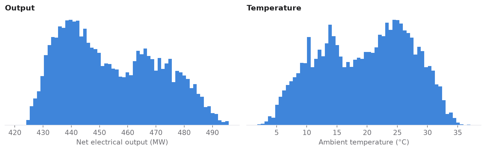
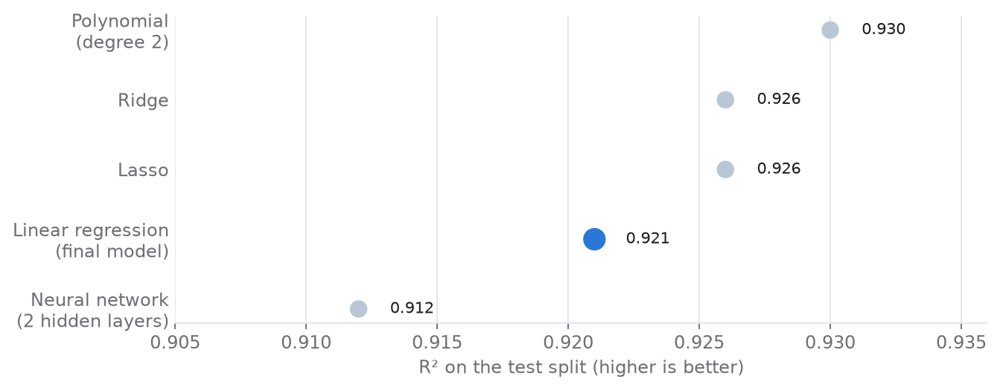
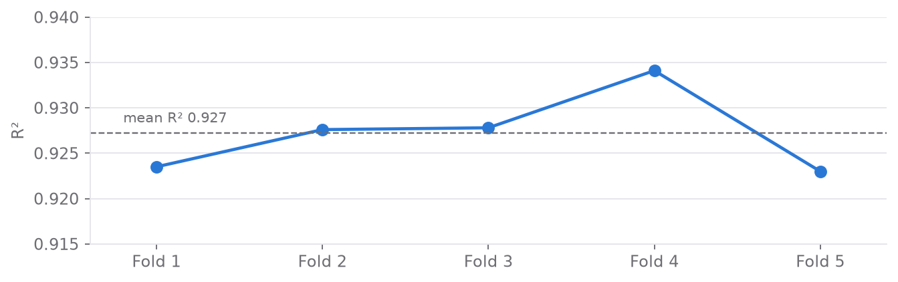

# Estimating Power Plant Output with Regression Models

   

**Case study:** [rolandkeszi.github.io/projects/power-plant.html](https://rolandkeszi.github.io/projects/power-plant.html)

This project models the electrical output of a combined cycle power plant from ambient conditions and uses the model to make predictions, building on machine learning and mathematical statistics. It is based on the case described by Tüfekci (2014).

## The task

The goal is to estimate the plant's net electrical output (**PE**, MW) from four ambient variables: ambient temperature (**AT**), exhaust vacuum (**V**), atmospheric pressure (**AP**) and relative humidity (**RH**).

- **Training set:** 8,568 observations, used for exploratory analysis and model comparison.
- **Independent test set:** 1,000 observations, used only to validate the final model.

The records span 2006–2011 but contain no time variable, so time-series analysis was not possible. I ran the analyses in Python and in IBM SPSS Statistics, and cross-checked the results between the two tools.

## Exploratory analysis

<p align="center"></p>

- **Two peaks:** both output (about 440 and 470 MW) and temperature (about 13 and 25 °C) have two clusters, most likely winter and summer operation.
- **Correlations with output:** temperature r = −0.95, exhaust vacuum r = −0.87, pressure r = 0.52, humidity r = 0.39.
- **Cleaning:** 36 duplicate rows were removed and a 1.5 × IQR outlier filter applied, leaving 8,440 observations.

## Modelling

Simple one-variable regressions show that temperature alone explains 90% of the variance in output (−2.17 MW per °C), but no single variable is sufficient.

For the multivariable model, the four SPSS variable-selection procedures (**forward, backward, stepwise, enter**) all converged on the same four-predictor model: **R² = 0.928**, standard error 4.59 MW, and all coefficients significant at p < 0.001.

<p align="center"></p>

| Model | Test R² | Note |
|---|---:|---|
| Polynomial regression (degree 2) | 0.930 | 15 terms, hard to interpret |
| Ridge regression | 0.926 | on a par with OLS |
| Lasso regression | 0.926 | on a par with OLS |
| **Linear regression (final model)** | **0.921** | chosen for interpretability |
| Neural network (TensorFlow, 2 hidden layers, 100 epochs) | 0.912 | RMSE 5.07 MW |

## Final model

With accuracy differences this small, I chose the **linear regression for its interpretability**:

```text
PE = 435.03 − 1.967·AT − 0.236·V + 0.081·AP − 0.157·RH
```

Holding the other conditions constant, **every additional °C of ambient temperature reduces output by about 2 MW**. On the training data the model reaches R² = 0.929, an MAE of 3.64 MW and an RMSE of 4.55 MW.

## Validation

- **5-fold cross-validation:** the mean R² is 0.927 and the mean MSE 21.1, and every fold falls in a narrow band.
- **Independent sample (N = 1,000):** the mean predicted output was 454.50 MW on the training data and 453.18 MW on the independent sample.
- **Homoscedasticity:** an F-test of the residual variances of the two samples gives **F = 1.016**. The variances are effectively equal, so the model generalises to unseen data.

<p align="center"></p>

## Conclusions

The four ambient variables give a reliable estimate of the plant's electrical output with a simple, transparent linear model, and temperature is by far the most important factor. I confirmed the model's validity with independent methods: cross-validation, an independent sample and a test of equal residual variances. The neural network did not improve on the linear model, although a differently designed network might.

**Limitations:** the data contain no timestamps, so effects such as equipment ageing could not be modelled. Domain-level engineering knowledge was outside the scope of this study.

## Further work: replication notebook

[`notebooks/power_plant_analysis.ipynb`](notebooks/power_plant_analysis.ipynb) replicates the workflow on the public UCI dataset and extends it with tree ensembles. Gradient boosting reached a test R² of 0.965 (RMSE 3.2 MW), and SHAP values confirmed temperature as the dominant driver. The notebook is fully executed, so its results are visible on GitHub.

```bash
pip install -r requirements.txt
jupyter notebook notebooks/power_plant_analysis.ipynb
```

## Repository structure

```text
├── notebooks/power_plant_analysis.ipynb   # replication and extension, executed
├── data/ccpp.csv                          # UCI dataset (CC BY 4.0)
├── figures/                               # charts used in this README
├── src/                                   # notebook and figure generators
└── requirements.txt
```

## Data and reference

[Combined Cycle Power Plant](https://archive.ics.uci.edu/dataset/294/combined+cycle+power+plant), UCI Machine Learning Repository, licensed CC BY 4.0.

> Tüfekci, P. (2014). Prediction of full load electrical power output of a base load operated combined cycle power plant using machine learning methods. *International Journal of Electrical Power & Energy Systems*, 60, 126–140.

## License

© 2026 Roland Keszi. This work is licensed under [CC BY-NC 4.0](https://creativecommons.org/licenses/by-nc/4.0/): you may share and adapt it for non-commercial purposes, provided you credit the author (Roland Keszi) and link to this repository. Third-party datasets keep their own licenses. See [`LICENSE`](LICENSE).
